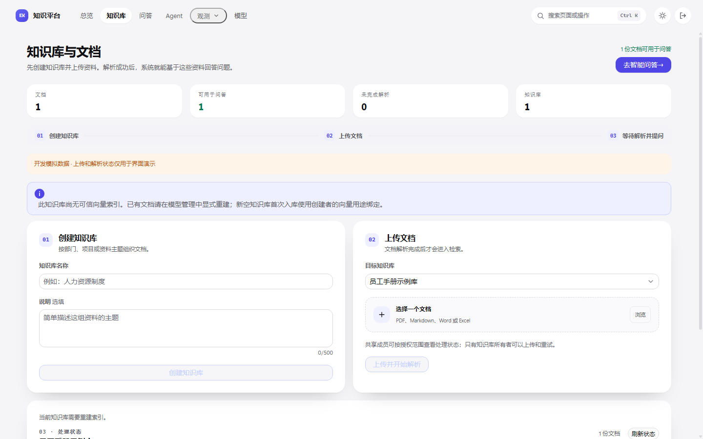
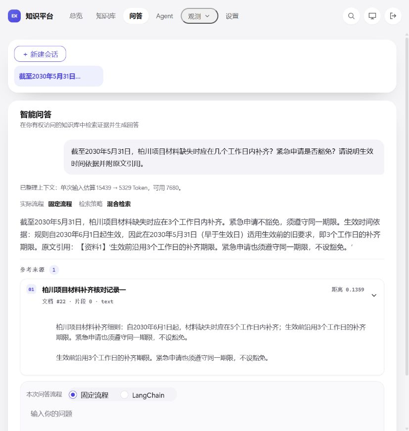
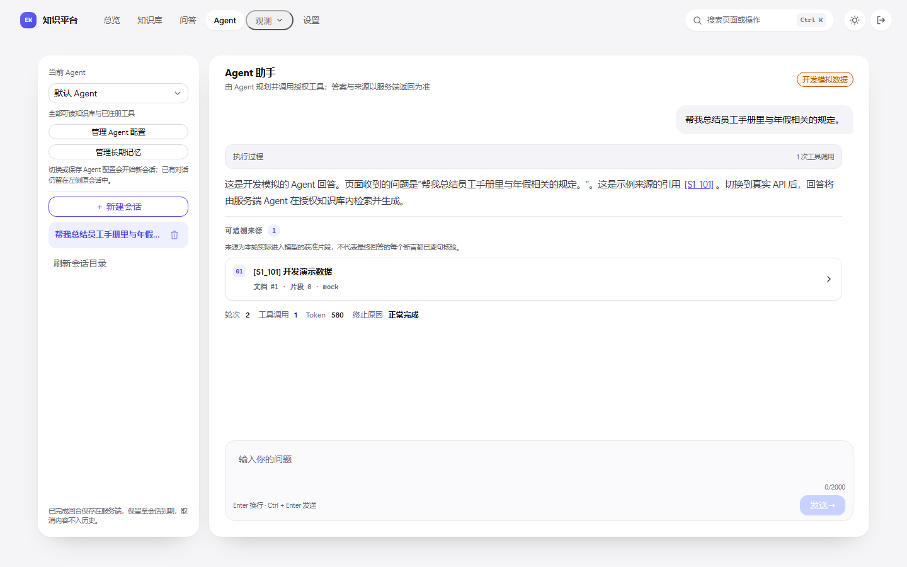
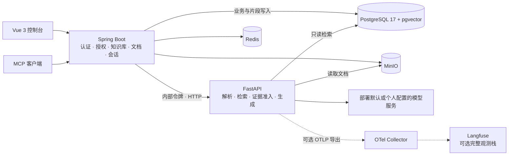

# EKIP · 企业智能知识管理平台

<a id="intro"></a>

EKIP 把分散在制度、手册和项目文档里的知识整理成可搜索的知识库。用户可以在获授权的资料范围内提问，并展开回答引用的原文。系统记录检索、证据审查和生成的执行过程，方便定位答案来自哪里。

**Vue 3 · Spring Boot · FastAPI · PostgreSQL / pgvector**

[快速开始](#quickstart) · [目录导航](#目录结构) · [本机配置与密钥](docs/local-configuration.md) · [架构设计](#architecture) · [使用文档](#docs)

<a id="showcase"></a>

## 核心功能

- **文档入库**。创建和共享知识库，上传 PDF、Office 文档或 Markdown，查看解析进度和分块正文。扫描 PDF 支持 OCR，文档任务支持取消和重试。
- **带原文引用的 RAG 问答**。在当前用户可读的知识库范围内做向量与关键词混合检索，可选重排。回答使用通过审查的证据，证据不足时明确说明；支持固定流程和 LangChain。
- **Agent 工具调用**。Agent 可在授权范围内检索和阅读文档，页面展示工具执行过程与引用来源。支持服务端会话和经用户审批的长期记忆。

Chat、Embedding 和 Rerank 可以分别接入本地或云端模型。Trace 页面可查看各阶段耗时、实际检索策略和证据判定。模型配置和详细模块说明见[文档入口](docs/README.md)。

## 页面截图

| 知识库与文档 | RAG 问答与原文引用 | Agent 工具调用 |
| --- | --- | --- |
| [](docs/images/readme/library.png) | [](docs/images/readme/rag.jpg) | [](docs/images/readme/agent.png) |

中图使用合成资料和真实模型调用。左右两图使用前端模拟数据展示交互。

<a id="quickstart"></a>

## 快速开始

### 只预览界面

安装 Node.js 20+ 后，从仓库根目录在 PowerShell 运行以下命令。

```powershell
cd frontend
npm ci
$env:VITE_USE_MOCK = 'true'
npm run dev -- --host 127.0.0.1
```

打开[本机控制台](http://127.0.0.1:5173/login)，输入示例用户名 `demo_user` 和密码 `Demo123456`。模拟模式使用前端示例数据，无需启动后端。切换到真实服务时，先停止 Vite，在同一终端执行 `Remove-Item Env:VITE_USE_MOCK`，再重新启动 Vite。

### 首次部署

准备 Docker Compose、Node.js 和可达的模型服务，从下方[环境与配置](#1-准备环境与配置)开始。依次配置 `.env`、启动 Java 和 AI 服务、设置 PostgreSQL 只读账号密码，再启动前端。登录后在[模型管理](docs/model-management.md#8-当前开发版本配置)确认 Chat、Embedding 和 Rerank 的用途与可用状态。

### 本机日常演示

沿用根目录 `.env`、已有账号和知识库。常用问答组合是 `fixed / hybrid-rerank / support`，模型用部署默认的 Qwen3 4B（8K）、Embedding 0.6B 和 Reranker 0.6B。

从仓库根目录运行一次 PowerShell 命令。

```powershell
& .\scripts\start-demo.ps1
```

首次配置时，用 `-RerankerModelPath` 或 PowerShell 环境变量 `EKIP_RERANKER_MODEL_PATH` 指定 GGUF。省略时脚本优先复用已有重排启动记录，再从 `OLLAMA_MODELS` 或仓库下的 `models/` 查找 `qwen3-reranker-0.6b-q8_0.gguf`。自定义 Ollama 模型位置可以用 `OLLAMA_MODELS` 指定。

脚本启动或复用 Docker Desktop、Ollama、本地重排、Compose 服务和 Vite。它会核对 Ollama 模型、用 Compose 中的重排凭证测试少量输入，并检查前端到 Java 和 AI 的代理。看到 `Ready` 后打开[本机控制台](http://127.0.0.1:5173/login)，沿[三问演示路线](scripts/context-capacity-demo/README.md)使用已有知识库。

日常启动复用现有的 Java 和 AI 镜像。修改过 Java 或 AI 源码时运行 `& .\scripts\start-demo.ps1 -Build`。前端通过 Vite 加载工作区源码。脚本启动的 Ollama 和 Vite 日志在 `logs/local-development/`。

首次安装或更换机器时，按以下步骤准备依赖、配置和模型。

### 1. 准备环境与配置

需要 Docker / Docker Compose、运行前端的 Node.js（建议 20+）与 npm，以及可达的所选模型服务。选择本地模型时，另准备可从 AI 容器访问的 Ollama 或相应服务。以下命令在仓库根目录执行，使用 PowerShell。已有 `.env` 时直接核对配置，跳过复制步骤。

```powershell
Copy-Item .env.example .env
```

编辑 `.env`，填写以下必需项。

| 变量 | 配置要求 |
| --- | --- |
| `JWT_SECRET` | 独立随机密钥，原始 UTF-8 字节数至少 32；可用 `openssl rand -base64 48` 生成 |
| `INTERNAL_API_TOKEN` | Java 与 Python 共用的内部令牌；可用 `openssl rand -hex 32` 生成 |
| `PG_READONLY_USER` | 使用迁移创建的 `rag_readonly` |
| `PG_READONLY_PASSWORD` | 为只读角色单独生成随机密码，后续同步设置到数据库 |
| `MODEL_CONFIG_ENCRYPTION_KEY` | 保存模型 API Key 时需要；独立随机 32 字节的 Base64 值，仅注入 Java |

`.env` 已被 Git 忽略。完整配置分组及加载规则见 [`.env.example`](.env.example)；只有 Compose 明确引用的变量才会传入容器。

如需账号管理，在根目录 `.env` 中设置 `EKIP_ACCOUNT_ADMIN_USERNAME` 为一个已注册且启用的用户名，然后重建并启动后端。该账号登录后可在「设置 → 账号管理」启用或禁用其他账号。先注册再配置，公开注册会保留配置的管理员用户名。禁用后已有访问和刷新令牌失效，重新启用须重新登录。

### 2. 确定模型服务

Chat、Embedding 与 Rerank 可分别选择本地或云端，通过登录后的模型管理页面登记。支持 OpenAI 兼容 Chat/Embedding、Cohere 兼容重排与百炼原生重排；本地 Ollama 也使用兼容接口。无需为启动服务预加载全部模型。

选择 Ollama 时使用 OpenAI 兼容协议和 `/v1` 地址；Docker Desktop 下 AI 容器访问宿主机可用 `http://host.docker.internal:11434/v1`。向量索引支持明确的 1024/2560 维空间，旧向量不自动归入新模型。8GB 显存是否足够仍取决于量化、上下文、KV cache 与驻留模型，默认本地资源组容量 1 仅限制同时调用；可将三个用途分别分配到不同服务。

本机轻量演示采用 Chat 4B、Embedding 0.6B、Rerank 0.6B。前两项由 Ollama 执行，重排由宿主机 llama.cpp 提供 Cohere 兼容接口。当前 support 按正文核验适用范围，并按“细则优先于制度”处理数值冲突。模型配置见[模型管理](docs/model-management.md)。

### 3. 启动业务与 AI 服务

```powershell
docker compose up -d --build backend minio-init
```

此命令启动 PostgreSQL、Redis、MinIO、建桶任务、AI 和 Java 后端，共 6 个服务。外部追踪栈按需启用。**Vue 前端在第 4 步单独启动。** 首次构建需要下载镜像和依赖。

Java 启动后会由 Flyway 建表并创建、收紧 `rag_readonly` 的权限。等待迁移完成，再进入 PostgreSQL：

```powershell
docker compose exec postgres psql -U postgres -d knowledge
```

在 `psql` 内设置只读角色密码，使其与 `.env` 中的 `PG_READONLY_PASSWORD` 一致：

```text
\password rag_readonly
\q
```

Flyway V5 不设置或轮换该密码；已有数据库也需核对。凭据生效后，AI 的依赖就绪状态会自行更新。

<details>
<summary><b>按需启用完整观测栈</b></summary>

默认保留产品 Trace、指标和阶段日志，外部追踪导出关闭。需要 Collector、ClickHouse 和 Langfuse Web/Worker 时，先按 [观测说明](docs/observability.md) 配置密钥与独立数据库，再显式合并可选文件：

```powershell
docker compose -f docker-compose.yml -f docker-compose.observability.yml up -d --build
```

合并后共 10 个服务。已有观测数据和容器不会因为文件拆分被自动清理；本轮没有执行部署切换。

</details>

<a id="5-启动前端"></a>

### 4. 启动前端

在未开启模拟模式的终端执行以下命令。

```powershell
cd frontend
npm ci
npm run dev -- --host 127.0.0.1
```

打开[登录页面](http://127.0.0.1:5173/login)。前端默认连接真实接口，`VITE_USE_MOCK` 应未设置或为 `false`。

<a id="4-创建首次登录账号"></a>

### 5. 创建首次登录账号

在登录页点击“没有账号？注册”，填写用户名、6–20 位密码和确认密码。注册成功后返回登录并保留用户名。

使用接口创建本地演示账号也可执行以下命令。

```powershell
$body = @{ username = 'demo_user'; password = 'Demo123456'; email = 'demo@example.test' } | ConvertTo-Json
Invoke-RestMethod -Method Post -Uri 'http://127.0.0.1:8080/user/register' -ContentType 'application/json' -Body $body
```

示例仅用于本地演示，请自行更换账号与密码；密码长度为 6–20 位。已有账号时可跳过。

登录后先在模型管理登记模型并预览，独立保存凭证、显式测试能力，再选择用途。新 KB 的向量模型采用创建者 Embedding 默认候选；已有 KB 由创建者选择只读维护窗口显式重建，等待影子索引全量成功后再恢复写入。真实连接测试会消耗供应商额度，预览不请求模型。完整流程见[当前版本配置说明](docs/model-management.md#8-当前开发版本配置)。

| 服务 | 默认地址 | 用途 |
| --- | --- | --- |
| Web 控制台 | `http://127.0.0.1:5173` | 知识库、文档、问答与观测页面 |
| Java API | `http://127.0.0.1:8080` | 认证、业务与对外接口 |
| Python AI | `http://127.0.0.1:8000` | 内部 AI 接口；业务调用需内部令牌 |
| MinIO 控制台 | `http://127.0.0.1:9001` | 对象存储管理 |
| Langfuse（完整栈） | `http://127.0.0.1:3000` | 模型调用追踪 |

### 6. 走通文档与检索流程

**登录 → 创建知识库 → 上传文档 → 等待解析成功 → 提问并查看来源 → 查看 Trace 与状态。**

可使用 [`ai/enterprise_docs/employee_handbook.pdf`](ai/enterprise_docs/employee_handbook.pdf) 作为合成演示样例，提问“年假需要提前几个工作日申请？”。生产阈值未配置时，应验证来源和证据准入提示；完整生成需先完成证据策略独立验收。

AI `/health` 仅表示进程存活。带内部令牌的 `/ready` 与前端状态页用于检查依赖和能力就绪情况；就绪状态不代表答案质量或端到端 SLA 已通过。

<a id="architecture"></a>

## 架构设计



| 运行单元 | 职责 |
| --- | --- |
| Vue 3 前端 | 知识库与文档、智能问答、Trace / 指标 / 状态；通过代理访问后端 |
| Java 业务后端 | 身份认证、知识库授权、上传与任务管理、入库写事务、会话、Agent 与 MCP |
| Python AI 服务 | 文档解析与切块、Embedding、只读检索、RAG 编排、证据审查、模型治理 |

**文档入库**：Java 校验权限并上传 MinIO → 建立文档与异步任务 → Python 解析切块 → Java 调用 Embedding 并在事务内替换片段。业务表与片段同库，数据库结构由 Flyway 管理。

**问答执行**：Java 授权并装配知识库范围 → 一次调用 Python `/rag/query` → 改写、检索、融合、重排、证据准入、可选后处理与生成 → Java 映射答案、来源和 Trace。Python 使用专用只读角色，内部接口由 `X-Internal-Token` 保护。

### 检索策略与可选处理

| 检索策略 `retrieval.version` | 执行内容 |
| --- | --- |
| `baseline` | 向量检索 |
| `hybrid` | 向量 + jieba 关键词检索，RRF 融合 |
| `hybrid-rerank` | 混合检索 + 重排 |
| `hybrid-rerank-rewrite`（默认） | 查询改写 + 混合检索 + 重排 |

编排引擎 `pipelineEngine=fixed|langchain` 与检索策略独立。两种引擎共用查询预算、并发准入、授权范围、证据策略及模型治理。

MMR 去冗余、抽取式压缩、small-to-big 父块展开均为可选项，默认关闭。压缩仅支持 `none` / `extractive`；父块展开需启用后重新入库。开启后的质量收益需按场景评测。

### 技术栈

| 层次 | 选型 |
| --- | --- |
| 前端 | Vue 3、TypeScript、Vite、Pinia、TDesign |
| 业务后端 | Java 17、Spring Boot 3.5、Spring Security、MyBatis-Plus、Flyway |
| AI 服务 | Python 3.10、FastAPI、LangChain Core、OpenAI 兼容模型客户端 |
| 数据库与检索 | PostgreSQL 17、pgvector、固定 `halfvec(1024/2560)` 分表 + HNSW、全文索引 GIN |
| 缓存与对象存储 | Redis、MinIO |
| 模型 | 按用户独立管理 Chat / Embedding / Rerank，本地与云端四协议，内部快照执行 |
| 可观测性 | Actuator、Prometheus 指标、OpenTelemetry、自托管 Langfuse |

<a id="docs"></a>

## 文档

| 主题 | 入口 |
| --- | --- |
| 前端控制台、页面与部署 | [frontend/README.md](frontend/README.md) |
| 业务后端与接口实现 | [knowledge-platform/README.md](knowledge-platform/README.md) |
| AI 服务、模型与重排配置 | [ai/README.md](ai/README.md) |
| 模型管理、凭证与历史索引迁移 | [docs/model-management.md](docs/model-management.md) |
| 文档总入口 | [文档入口](docs/README.md) |
| 编码助手 | [项目框架与修改规则](AGENTS.md) · [源码入口](docs/architecture/modules/README.md) |
| 架构与设计决策 | [运行单元与调用关系](#架构设计) · [架构减法决策](docs/architecture/2026-11-03-refactoring-decision.md) |
| 文档任务状态图 | [文档生命周期](docs/architecture/ekip-document-lifecycle.html) |
| 测试与故障验收 | [测试目录](tests/README.md) · [双管线验证](scripts/rag-pipeline-validation/README.md) |

<a id="development"></a>

## 开发指南

### 目录结构

| 目录 | 负责什么 | 从哪里开始 |
| --- | --- | --- |
| [`frontend/`](frontend/) | Vue 控制台、页面交互和 API 调用 | [前端手册](frontend/README.md) · [页面路由](frontend/src/router/index.ts) |
| [`knowledge-platform/`](knowledge-platform/) | Java 业务后端，负责授权、文档任务、会话和 Agent 工具 | [后端手册](knowledge-platform/README.md) · [启动类](knowledge-platform/src/main/java/com/pony/knowledge/KnowledgeApplication.java) · [数据库迁移](knowledge-platform/src/main/resources/db/migration/) |
| [`ai/`](ai/) | Python AI 服务，负责解析、切分、检索和模型调用 | [AI 手册](ai/README.md) · [FastAPI 入口](ai/app/main.py) |
| [`scripts/`](scripts/) | 启动本机演示、检查部署、运行诊断 | [脚本索引](scripts/README.md) |
| [`tests/`](tests/) | 跨服务回归、共享夹具和测试运行说明 | [测试索引](tests/README.md) |
| [`docker/`](docker/) | 容器基础设施，当前收录外部追踪采集配置 | [部署文件索引](docker/README.md) |
| [`docs/`](docs/) | 使用手册、架构与接口契约 | [文档入口](docs/README.md) · [按功能找源码](docs/architecture/modules/README.md) |

### 根目录文件

| 文件 | 负责什么 |
| --- | --- |
| [`README.md`](README.md) | 项目首页、快速开始和开发入口 |
| [`AGENTS.md`](AGENTS.md) · [`CLAUDE.md`](CLAUDE.md) | 编码助手实查源码和改动项目的规则 |
| [`docker-compose.yml`](docker-compose.yml) | 启动 Java、AI 及 PostgreSQL、Redis、MinIO 等依赖 |
| [`docker-compose.observability.yml`](docker-compose.observability.yml) · [`docker-compose.dev-test.yml`](docker-compose.dev-test.yml) | 按需叠加外部追踪或 RAG 连通性联调 |
| [`.env.example`](.env.example) | 可分享的部署变量模板 |
| [`.gitignore`](.gitignore) · [`.dockerignore`](.dockerignore) | 分别定义 Git 跟踪和 Docker 构建上下文的排除项 |

本机运行时，`logs/` 收集服务和诊断输出，`tmp/` 存放临时工作材料，`models/` 可放本地模型权重。这些目录由 Git 忽略。

本机配置文件、密钥文件和模型凭证的位置及读取顺序见[本机配置与密钥](docs/local-configuration.md)。

### 本地开发与检查

需要 Java 17 / Maven、Python 3.10 和前端依赖。分别运行三个进程的配置与启动步骤见各服务 README；Python 必须从仓库根目录按 `ai.app.*` 导入，Windows 终端设置 `PYTHONUTF8=1`。

```powershell
# Java：编译；测试时按变更范围指定测试类
mvn -f knowledge-platform/pom.xml compile
mvn -f knowledge-platform/pom.xml '-Dtest=RagServiceAskTest,PythonRagPipelineTest' test

# Python：与 RAG 授权相关的定向回归
$env:PYTHONUTF8 = '1'
python -m pytest ai/tests/test_rag_retrieval_authz.py

# 前端：类型检查与构建（在 frontend/ 内执行）
npm run typecheck
npm run build
```

部分集成测试与 E2E 依赖真实 PostgreSQL、Redis、MinIO 或模型服务；运行要求见[测试目录说明](tests/README.md)。

### 部署与排错要点

- **源码更新**：backend / ai 使用本地构建镜像；修改后执行 `docker compose up -d --build backend ai`，加载新的代码与依赖。
- **前端托管**：Compose 未包含 frontend 服务。正式托管需配置 SPA 路由回退及 `/api`、`/ai` 代理，细节见[前端部署说明](frontend/README.md#构建与部署)。
- **Redis**：RAG 多轮会话与 Agent 记忆固定使用 Redis，故障时不静默切换到内存。内存替身仅在测试源码中，不提供运行时切换选项。
- **代理与登录**：可信反向代理需正确传递 `X-Forwarded-For`，以便按客户端 IP 限流。轮换 `JWT_SECRET` 后需重启后端，已签发访问令牌会失效。
- **端口**：标准端口为 5432 / 6379 / 8000 / 8080 / 9000–9001。Windows 绑定失败时先用 `netsh int ipv4 show excludedportrange protocol=tcp` 排查保留端口；容器与本机服务避免占用同一端口。
- **部署范围**。多实例文档任务的租约恢复与 SSE 状态广播见[文档任务](docs/architecture/modules/tasks.md)。生产部署应替换 Compose 使用的本地开发存储凭据及访问配置。

<a id="validation"></a>

## 验证状态

文档入库、带原文引用的问答和 Agent 检索已有本地定向运行记录。本项目处于开发阶段，完整质量、故障与性能容量评估仍在推进。项目自带的验证入口见[测试目录](tests/README.md)。
